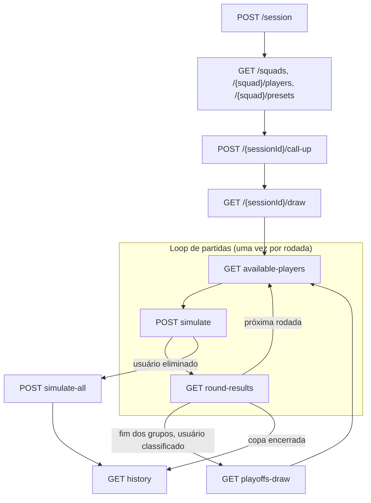

# Server

API do simulador de campeonato. Flask, em três camadas: **controllers** (HTTP) → **services** (regras da copa) → **repositories** (armazenamento).

Os dados ficam no **MongoDB** (ou em memória, para desenvolvimento rápido) e as partidas, por enquanto, são resolvidas por um simulador aleatório no lugar do modelo. Banco e modelo ficam atrás de interfaces, então trocar um ou outro não mexe em services nem controllers (veja [Trocando implementações](#trocando-implementações)).

## Rodando com Docker (API + MongoDB)

Requer Docker com Compose.

```bash
docker compose up -d --build
```

- API: http://127.0.0.1:5000
- MongoDB: `mongodb://127.0.0.1:27018` (porta 27018 no host, para não conflitar com um Mongo local na 27017), banco `copa`

Os dados ficam no volume `copa-simulador_mongo-data` e sobrevivem a reinícios. Na primeira subida, a API carrega no banco as seleções e jogadores mock, se as coleções estiverem vazias. As duas portas só escutam em `127.0.0.1`, e o Mongo não tem autenticação, então isto é para uso local.

```bash
docker compose logs -f api   # logs
docker compose down          # para tudo (mantém os dados)
docker compose down -v       # para tudo e apaga os dados
```

O container usa o servidor embutido do Flask, que avisa nos logs que não é para produção.

## Documentação (Swagger)

Com a API rodando (Docker ou local):

- http://127.0.0.1:5000/docs: Swagger UI, para navegar pelos endpoints e testá-los com "Try it out" (`/` redireciona para cá);
- http://127.0.0.1:5000/openapi.json: o documento OpenAPI 3.1, que pode ser importado no Postman ou usado para gerar um cliente Kotlin.

O documento fica em `api/controllers/openapi.py`. Os enums vêm direto do domínio, e os testes conferem cada resposta da API contra os schemas (`tests/openapi_check.py`), então mudar uma resposta sem atualizar o documento quebra os testes. A página carrega o Swagger UI do CDN jsDelivr (versão fixa, com hash de integridade), então o navegador precisa de internet; a API em si não.

Os exemplos de corpo na página (`call-up` e `simulate`) usam ids válidos dos dados mock: convocação do Brasil e um time titular.

## Rodando localmente

Requer [uv](https://docs.astral.sh/uv/) e Python 3.14.

```bash
uv sync
uv run flask --app main run --debug
```

Por padrão os dados ficam em memória (`REPOSITORY=memory`) e somem quando o processo para. Para usar o Mongo do Docker:

```bash
REPOSITORY=mongo MONGO_URI=mongodb://127.0.0.1:27018 uv run flask --app main run --debug
```

## Testes

```bash
uv run pytest
```

São testes unitários: cada teste de fluxo roda duas vezes, uma com os repositórios em memória e outra com os repositórios MongoDB sobre o [mongomock](https://github.com/mongomock/mongomock), um MongoDB falso em memória. Não precisam de banco rodando.

Os testes funcionais em `tests/functional/` falam HTTP com a stack do Docker e conferem o que foi gravado no Mongo. Sem `API_BASE_URL` eles são pulados.

```bash
docker compose up -d --build
API_BASE_URL=http://127.0.0.1:5000 MONGO_URI=mongodb://127.0.0.1:27018 uv run pytest tests/functional -v
```

## Fluxo



O loop roda seis vezes para quem chega ao fim: três rodadas de grupos, quartas, semifinal e a rodada final (final e disputa de 3º lugar acontecem juntas).

## Endpoints

Não há autenticação (ainda): o `sessionId` devolvido por `POST /session` identifica o usuário. Os campos do JSON são camelCase.

| Endpoint | O que faz |
|---|---|
| `POST /session` | Cria a sessão e devolve `{sessionId}`. |
| `GET /squads` | As 16 seleções: `id`, `name`, `flag` (URL da imagem), `federation`. |
| `GET /{squad}/players?position=` | Jogadores da seleção: `id`, `name`, `age`, `position`, `overall`. `position` é opcional (`GK`, `DEF`, `MID`, `FW`). |
| `GET /{squad}/presets` | Convocações prontas: `current`, `legends` e `random`. |
| `POST /{sessionId}/call-up` | Corpo `{squad, players}`. Exige 26 jogadores da seleção: 3 GK, 8 DEF, 8 MID, 7 FW. Pode ser reenviado até o sorteio. |
| `GET /{sessionId}/draw` | Sorteia 4 grupos de 4 (com a seleção do usuário), define o elenco das outras 15 seleções e a tabela de jogos. Chamadas seguintes devolvem o mesmo sorteio. |
| `GET /{sessionId}/available-players` | `available` e `unavailable` (com `reason` e `matchesRemaining`). |
| `POST /{sessionId}/simulate` | Corpo `{players, formation?}` com os 11 titulares (exatamente 1 goleiro). Simula a partida do usuário na rodada atual e fecha a rodada. Devolve `match` e `next`. |
| `GET /{sessionId}/round-results` | Todos os jogos da rodada que acabou de ser jogada. Nos grupos traz a classificação (`groups`) e, na 3ª rodada, `qualified`. No mata-mata traz `advanced`; na rodada final, `podium`. |
| `GET /{sessionId}/playoffs-draw` | Sorteia as quartas entre os 8 classificados. QF1 × QF2 e QF3 × QF4 se encontram nas semifinais. |
| `POST /{sessionId}/simulate-all` | Simula o resto da copa. Só depois que o usuário foi eliminado. Devolve o mesmo que `history`. |
| `GET /{sessionId}/history` | Classificação dos grupos, chaveamento, todas as partidas jogadas, o caminho do usuário (`userPath`), `placement` e `podium`. |

`next.step` em `POST /simulate` diz o que fazer em seguida:

| Valor | Significado |
|---|---|
| `NEXT_ROUND` | Há outra partida; `stage`, `round` e `opponent` vêm preenchidos. |
| `AWAITING_PLAYOFFS_DRAW` | Fase de grupos encerrada e usuário classificado: chamar `playoffs-draw`. |
| `THIRD_PLACE_MATCH` | Perdeu a semifinal: ainda há a disputa de 3º lugar. |
| `ELIMINATED` | Fora da copa: chamar `simulate-all`. |
| `FINISHED` | A copa acabou: chamar `history`. |

Erros têm sempre o formato `{"error": {"code", "message"}}`: `400` para corpo ou parâmetro inválido, `404` para sessão ou seleção inexistente, `409` quando a sessão não está na etapa certa (por exemplo, `simulate` antes do sorteio).

### Suspensões e lesões

Valem só para o elenco do usuário e ficam em `api/config.py`:

- cartão vermelho: fora da próxima partida;
- segundo amarelo acumulado: fora da próxima partida, e a contagem zera;
- lesão: fora pelo número de partidas que o modelo devolver.

## Estrutura

```
main.py                 ponto de entrada
Dockerfile              imagem da API
docker-compose.yml      API + MongoDB
api/
  __init__.py           create_app()
  config.py             Settings: cotas do elenco, regras de suspensão, banco e simulador em uso
  container.py          monta repositórios, simulador e services
  errors.py             erros da API e sua tradução para JSON
  domain/               entidades (models.py) e regras puras (rules.py)
  controllers/          blueprints Flask e serialização
  services/             regras de negócio, um service por etapa do fluxo
  repositories/         interfaces (base.py), MongoDB (mongo.py), memória (memory.py) e dados mock
  simulation/           interface do modelo (base.py) e o simulador aleatório (mock.py)
tests/                  testes unitários (banco falso com mongomock)
  functional/           testes contra a stack do Docker
```

## Trocando implementações

Tudo passa por `api/container.py`, o único lugar que conhece as implementações concretas. As variáveis de ambiente escolhem qual usar:

| Variável | Valores | Padrão |
|---|---|---|
| `REPOSITORY` | `memory`, `mongo` | `memory` (no Docker: `mongo`) |
| `MONGO_URI` | URI de conexão | `mongodb://localhost:27017` |
| `MONGO_DB` | nome do banco | `copa` |
| `SIMULATOR` | `mock` | `mock` |

**Modelo de simulação.** Implemente `MatchSimulator` (`api/simulation/base.py`):

- `simulate_match(context)`: simulação completa, usada nas partidas do usuário;
- `simulate_quick(context)`: versão mais fraca, usada nas demais partidas.

As duas recebem um `MatchContext` (os 11 de cada lado, a fase e se o jogo precisa de vencedor) e devolvem um `MatchResult` (placar, gols, cartões, lesões e pênaltis quando houver). Registre a classe em `SIMULATORS` e suba com `SIMULATOR=<nome>`.

**Banco de dados.** O MongoDB já está implementado em `api/repositories/mongo.py`, com as coleções `squads`, `players`, `sessions`, `tournaments` e `matches`. Outro banco precisa implementar as quatro interfaces de `api/repositories/base.py` e ser registrado em `REPOSITORIES`. Regra importante: o que `get`/`list_*` devolvem é uma cópia, e uma alteração só vale depois de `save`/`save_matches`, como em qualquer banco. O repositório em memória segue a mesma regra, para que os testes peguem quem esquecer de salvar.

Os testes usam esse mesmo caminho: `tests/conftest.py` injeta os repositórios e um simulador determinístico com `build_container(repositories=..., simulator=...)`.
