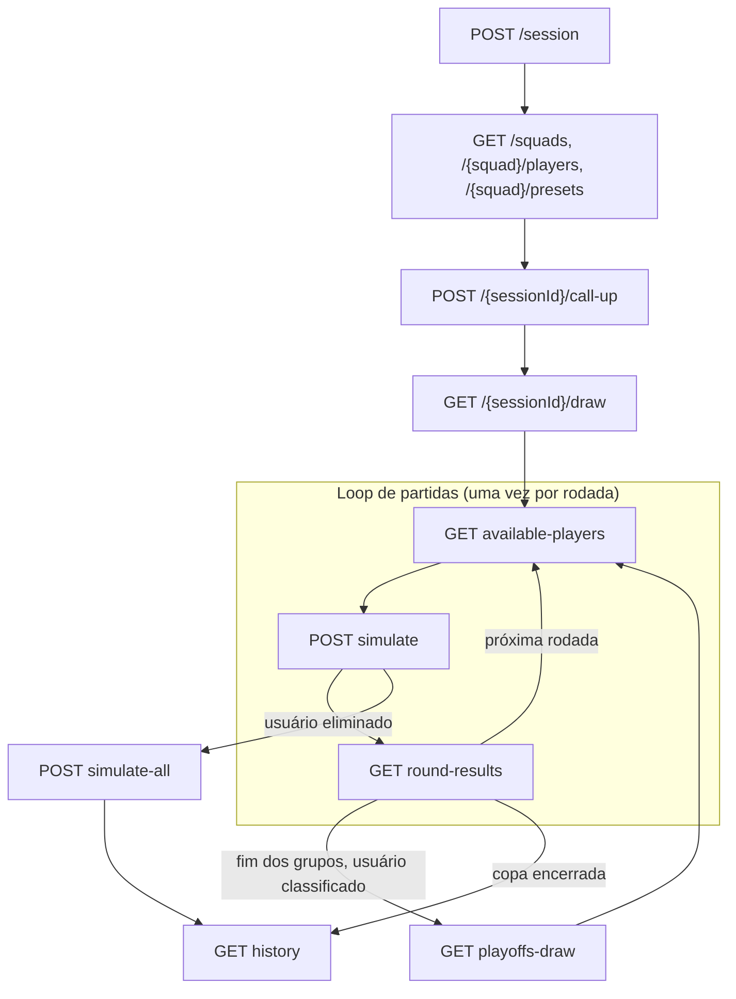

# Server

API do simulador de campeonato. Flask, em três camadas: **controllers** (HTTP) → **services** (regras da copa) → **repositories** (armazenamento).

Por enquanto o banco e o modelo de simulação são mocks: os dados ficam em memória e as partidas são resolvidas por um simulador aleatório. Os dois ficam atrás de interfaces, então trocar pelo real não mexe em services nem controllers (veja [Trocando os mocks](#trocando-os-mocks)).

## Rodando

Requer [uv](https://docs.astral.sh/uv/) e Python 3.14.

```bash
uv sync
uv run flask --app main run --debug
```

A API sobe em http://127.0.0.1:5000.

```bash
uv run pytest
```

## Fluxo



O loop roda seis vezes para quem chega ao fim: três rodadas de grupos, quartas, semifinal e a rodada final (final e disputa de 3º lugar acontecem juntas).

## Endpoints

Não há autenticação (ainda): o `sessionId` devolvido por `POST /session` identifica o usuário. Os campos do JSON são camelCase.

| Endpoint | O que faz |
|---|---|
| `POST /session` | Cria a sessão e devolve `{sessionId}`. |
| `GET /squads` | As 16 seleções: `id`, `name`, `flag` (URL da imagem), `federation`. |
| `GET /{squad}/players?position=` | Jogadores da seleção: `id`, `name`, `age`, `position`, `overall`. `position` é opcional (`GK`, `DEF`, `MID`, `FW`). |
| `GET /{squad}/presets` | Convocações prontas: `current`, `legends` e `random`. |
| `POST /{sessionId}/call-up` | Corpo `{squad, players}`. Exige 26 jogadores da seleção: 3 GK, 8 DEF, 8 MID, 7 FW. Pode ser reenviado até o sorteio. |
| `GET /{sessionId}/draw` | Sorteia 4 grupos de 4 (com a seleção do usuário), define o elenco das outras 15 seleções e a tabela de jogos. Chamadas seguintes devolvem o mesmo sorteio. |
| `GET /{sessionId}/available-players` | `available` e `unavailable` (com `reason` e `matchesRemaining`). |
| `POST /{sessionId}/simulate` | Corpo `{players, formation?}` com os 11 titulares (exatamente 1 goleiro). Simula a partida do usuário na rodada atual e fecha a rodada. Devolve `match` e `next`. |
| `GET /{sessionId}/round-results` | Todos os jogos da rodada que acabou de ser jogada. Nos grupos traz a classificação (`groups`) e, na 3ª rodada, `qualified`. No mata-mata traz `advanced`; na rodada final, `podium`. |
| `GET /{sessionId}/playoffs-draw` | Sorteia as quartas entre os 8 classificados. QF1 × QF2 e QF3 × QF4 se encontram nas semifinais. |
| `POST /{sessionId}/simulate-all` | Simula o resto da copa. Só depois que o usuário foi eliminado. Devolve o mesmo que `history`. |
| `GET /{sessionId}/history` | Classificação dos grupos, chaveamento, todas as partidas jogadas, o caminho do usuário (`userPath`), `placement` e `podium`. |

`next.step` em `POST /simulate` diz o que fazer em seguida:

| Valor | Significado |
|---|---|
| `NEXT_ROUND` | Há outra partida; `stage`, `round` e `opponent` vêm preenchidos. |
| `AWAITING_PLAYOFFS_DRAW` | Fase de grupos encerrada e usuário classificado: chamar `playoffs-draw`. |
| `THIRD_PLACE_MATCH` | Perdeu a semifinal: ainda há a disputa de 3º lugar. |
| `ELIMINATED` | Fora da copa: chamar `simulate-all`. |
| `FINISHED` | A copa acabou: chamar `history`. |

Erros têm sempre o formato `{"error": {"code", "message"}}`: `400` para corpo ou parâmetro inválido, `404` para sessão ou seleção inexistente, `409` quando a sessão não está na etapa certa (por exemplo, `simulate` antes do sorteio).

### Suspensões e lesões

Valem só para o elenco do usuário e ficam em `api/config.py`:

- cartão vermelho: fora da próxima partida;
- segundo amarelo acumulado: fora da próxima partida, e a contagem zera;
- lesão: fora pelo número de partidas que o modelo devolver.

## Estrutura

```
main.py                 ponto de entrada
api/
  __init__.py           create_app()
  config.py             Settings: cotas do elenco, regras de suspensão, seleção dos mocks
  container.py          monta repositórios, simulador e services
  errors.py             erros da API e sua tradução para JSON
  domain/               entidades (models.py) e regras puras (rules.py)
  controllers/          blueprints Flask e serialização
  services/             regras de negócio, um service por etapa do fluxo
  repositories/         interfaces (base.py), implementação em memória e dados mock
  simulation/           interface do modelo (base.py) e o simulador aleatório (mock.py)
tests/
```

## Trocando os mocks

Tudo passa por `api/container.py`, o único lugar que conhece as implementações concretas.

**Modelo de simulação.** Implemente `MatchSimulator` (`api/simulation/base.py`):

- `simulate_match(context)`: simulação completa, usada nas partidas do usuário;
- `simulate_quick(context)`: versão mais fraca, usada nas demais partidas.

As duas recebem um `MatchContext` (os 11 de cada lado, a fase e se o jogo precisa de vencedor) e devolvem um `MatchResult` (placar, gols, cartões, lesões e pênaltis quando houver). Registre a classe em `SIMULATORS` e suba com `SIMULATOR=<nome>`.

**Banco de dados.** Implemente as quatro interfaces de `api/repositories/base.py` (`SquadRepository`, `PlayerRepository`, `SessionRepository`, `TournamentRepository`), registre em `REPOSITORIES` e suba com `REPOSITORY=<nome>`.

Os testes usam esse mesmo caminho: `tests/conftest.py` injeta um simulador determinístico com `build_container(simulator=...)`.
