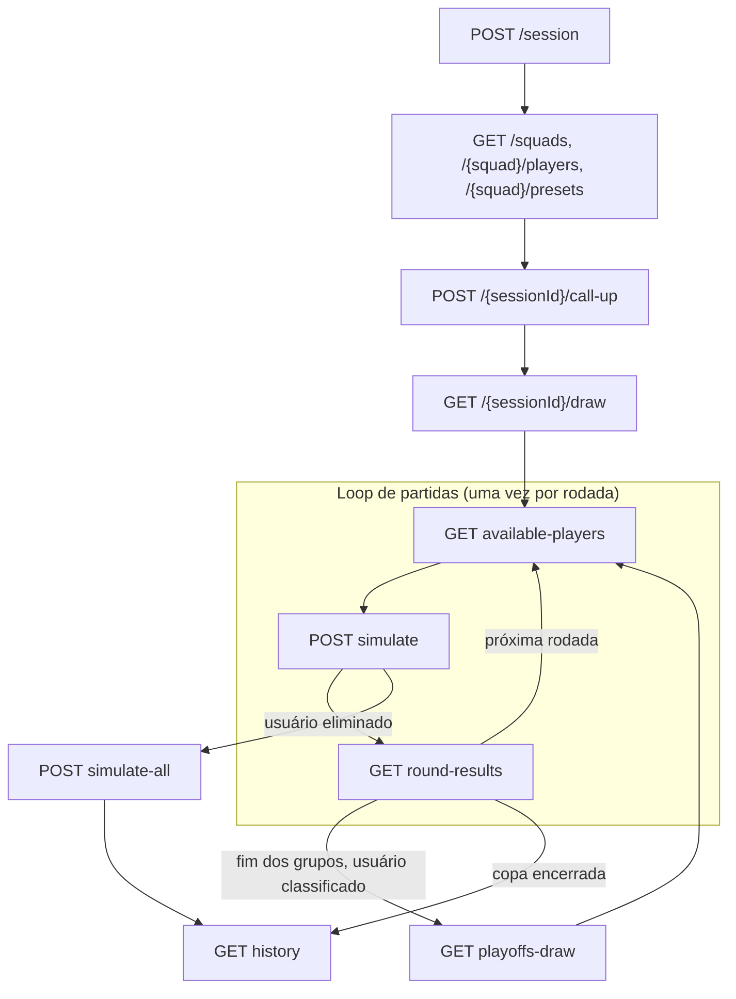

# Server

API do simulador de campeonato. Flask, em três camadas: **controllers** (HTTP) → **services** (regras da copa) → **repositories** (armazenamento).

Os dados ficam no **MongoDB** (ou em memória, para desenvolvimento rápido). As partidas são simuladas pelo **motor** (`simulador/engine`, pacote `copa_engine`), uma dependência editável do servidor; o sorteio dos grupos, a classificação e o chaveamento também são os do motor. Os jogadores são os reais, carregados no Mongo a partir do arquivo final do pipeline de dados (`pipeline-dados/artefatos/jogadores_copa_america_2024_filtrado.csv`). Banco e modelo ficam atrás de interfaces, então trocar um ou outro não mexe em services nem controllers (veja [Trocando implementações](#trocando-implementações)).

## Rodando com Docker (API + MongoDB)

Requer Docker com Compose.

```bash
docker compose up -d --build
```

- API: http://127.0.0.1:5000
- MongoDB: `mongodb://127.0.0.1:27018` (porta 27018 no host, para não conflitar com um Mongo local na 27017), banco `copa`

As portas do host podem ser trocadas com `API_PORT` e `MONGO_PORT` (por exemplo, para subir uma segunda stack com `docker compose -p outra up`).

**Ordem de subida.** O compose cuida dela sozinho: `mongo` fica saudável → `seed` (serviço de uma execução só) carrega o catálogo real e termina → só então sobe a `api`. Um `docker compose up` num volume vazio já semeia e serve; nos seguintes, o `seed` vê que o arquivo é o mesmo já carregado e não faz nada. Se o catálogo estiver vazio, a API se recusa a subir (com uma mensagem dizendo para rodar o seed), em vez de servir dados falsos.

Os dados ficam no volume `copa-simulador_mongo-data` e sobrevivem a reinícios. As duas portas só escutam em `127.0.0.1`, e o Mongo não tem autenticação, então isto é para uso local.

```bash
docker compose logs -f api   # logs
docker compose logs seed     # o que o seed carregou
docker compose down          # para tudo (mantém os dados)
docker compose down -v       # para tudo e apaga os dados
```

A imagem é construída a partir de `simulador/` (o servidor precisa do motor em `../engine`): o `Dockerfile` copia só `engine/copa_engine`, `engine/pyproject.toml` e o código do servidor. O container usa o servidor embutido do Flask, que avisa nos logs que não é para produção.

### Recarregando o catálogo

O `seed` lê o arquivo de `pipeline-dados/artefatos` (montado só para leitura). Depois de regenerar o arquivo no pipeline (`python -m pipeline.cli build-catalog`, veja `pipeline-dados/README.md`):

```bash
docker compose run --rm seed       # ou: docker compose up -d (o seed roda antes da api)
```

Fora do Docker, o mesmo comando, com a conexão em `MONGO_URI`/`MONGO_DB`:

```bash
MONGO_URI=mongodb://127.0.0.1:27018 uv run python -m api.seed --file ../../pipeline-dados/artefatos/jogadores_copa_america_2024_filtrado.csv
```

O seed valida o arquivo inteiro antes de escrever e recusa, com linha, nome e motivo, ids repetidos, campos do motor ausentes ou fora de [0, 100], seleções desconhecidas e seleções sem gente suficiente para uma convocação (3 GK, 8 DEF, 8 MID e 7 FW pessoas distintas). Ele grava em `squads_new`/`players_new` e troca as coleções com um `rename`, então uma falha nunca deixa o catálogo pela metade. O documento `catalog_meta` guarda a versão (os 12 primeiros dígitos do SHA-256 do arquivo), o hash e a data. Um catálogo novo encerra as sessões criadas no anterior: elas passam a responder `409 CATALOG_CHANGED` (os ids dos jogadores delas não valem mais).

### O que está rodando: `GET /meta`

```bash
curl http://127.0.0.1:5000/meta
# {"simulator": "engine", "catalogVersion": "1933dbb180c0"}
```

`catalogVersion` é `mock` quando o catálogo é o gerado (sem `catalog_meta`).

## Documentação (Swagger)

Com a API rodando (Docker ou local):

- http://127.0.0.1:5000/docs: Swagger UI, para navegar pelos endpoints e testá-los com "Try it out" (`/` redireciona para cá);
- http://127.0.0.1:5000/openapi.json: o documento OpenAPI 3.1, que pode ser importado no Postman ou usado para gerar um cliente Kotlin.

O documento fica em `api/controllers/openapi.py`. Os enums vêm direto do domínio, e os testes conferem cada resposta da API contra os schemas (`tests/openapi_check.py`), então mudar uma resposta sem atualizar o documento quebra os testes. A página carrega o Swagger UI do CDN jsDelivr (versão fixa, com hash de integridade), então o navegador precisa de internet; a API em si não.

Os exemplos de corpo na página (`call-up` e `simulate`) usam ids válidos dos dados mock: convocação do Brasil e um time titular. Com o catálogo real, pegue os ids em `GET /brazil/presets`.

## Rodando localmente

Requer [uv](https://docs.astral.sh/uv/) e Python 3.14. O `uv sync` instala o motor (`../engine`) em modo editável.

```bash
uv sync
SIMULATOR=engine uv run flask --app main run --debug
```

Por padrão os dados ficam em memória (`REPOSITORY=memory`), com o catálogo mock gerado, e somem quando o processo para. Para usar o Mongo do Docker (já semeado pelo serviço `seed`):

```bash
REPOSITORY=mongo MONGO_URI=mongodb://127.0.0.1:27018 SIMULATOR=engine uv run flask --app main run --debug
```

Num Mongo vazio, rode o seed antes ou suba com `SEED_MOCK_CATALOG=1` para usar os dados mock.

## Testes

```bash
uv run pytest                                  # servidor
(cd ../engine && uv run pytest)                # motor
```

São testes unitários: cada teste de fluxo roda duas vezes, uma com os repositórios em memória e outra com os repositórios MongoDB sobre o [mongomock](https://github.com/mongomock/mongomock), um MongoDB falso em memória. Não precisam de banco rodando. `tests/test_seed.py` também confere que o arquivo real do pipeline é aceito pelo seed, e `tests/test_engine.py` joga copas inteiras no motor.

Os testes funcionais em `tests/functional/` falam HTTP com a stack do Docker e conferem o que foi gravado no Mongo (e, com o catálogo real, Messi na Argentina, o Canadá e as 16 seleções). Sem `API_BASE_URL` eles são pulados.

```bash
docker compose up -d --build
API_BASE_URL=http://127.0.0.1:5000 MONGO_URI=mongodb://127.0.0.1:27018 uv run pytest tests/functional -v
```

O hook de pre-commit (`.githooks/pre-commit`, ative com `git config core.hooksPath .githooks`) roda os testes do motor quando há algo em `simulador/engine/` no commit e os do servidor quando há algo em `simulador/server/`.

## Fluxo



O loop roda seis vezes para quem chega ao fim: três rodadas de grupos, quartas, semifinal e a rodada final (final e disputa de 3º lugar acontecem juntas).

## Endpoints

Não há autenticação (ainda): o `sessionId` devolvido por `POST /session` identifica o usuário. Os campos do JSON são camelCase.

| Endpoint | O que faz |
|---|---|
| `GET /meta` | O simulador em uso e a versão do catálogo. |
| `POST /session` | Cria a sessão e devolve `{sessionId}`. |
| `GET /squads` | As 16 seleções: `id`, `name`, `flag` (URL da imagem), `federation`. |
| `GET /{squad}/players?position=` | Jogadores da seleção: `id`, `name`, `age`, `position` (setor da posição principal), `positions` (códigos do dataset, a principal primeiro), `overall`. `position` é opcional (`GK`, `DEF`, `MID`, `FW`). |
| `GET /{squad}/presets` | Convocações prontas: `current` (os convocados de 2024, completados pelo overall; convocados além da cota de uma posição ficam de fora), `legends` (lendas primeiro) e `random`. |
| `POST /{sessionId}/call-up` | Corpo `{squad, players}`. Exige 26 jogadores da seleção: 3 GK, 8 DEF, 8 MID, 7 FW, e uma versão por pessoa (a versão atual e a lenda de um jogador não entram juntas). Pode ser reenviado até o sorteio. |
| `GET /{sessionId}/draw` | Define o elenco das outras 15 seleções, divide as 16 em potes pela força do time titular e sorteia 4 grupos de 4 (um time de cada pote) e a tabela de jogos. Chamadas seguintes devolvem o mesmo sorteio. |
| `GET /{sessionId}/available-players` | `available` e `unavailable` (com `reason` e `matchesRemaining`). |
| `POST /{sessionId}/simulate` | Corpo `{players, formation?}` com os 11 titulares (exatamente 1 goleiro) no formato da formação: `4-4-2` (padrão), `4-3-3`, `3-5-2` ou `4-2-3-1`. O servidor decide quem joga em cada slot e devolve isso em `match.lineup`. Simula a partida do usuário na rodada atual e fecha a rodada. Devolve `match` e `next`. |
| `GET /{sessionId}/round-results` | Todos os jogos da rodada que acabou de ser jogada. Nos grupos traz a classificação (`groups`) e, na 3ª rodada, `qualified`. No mata-mata traz `advanced`; na rodada final, `podium`. |
| `GET /{sessionId}/playoffs-draw` | Revela as quartas, que seguem a classificação: QF1 = 1º A × 2º B, QF2 = 1º B × 2º A, QF3 = 1º D × 2º C, QF4 = 1º C × 2º D. QF1 × QF2 e QF3 × QF4 se encontram nas semifinais. |
| `POST /{sessionId}/simulate-all` | Simula o resto da copa. Só depois que o usuário foi eliminado. Devolve o mesmo que `history`. |
| `GET /{sessionId}/history` | Classificação dos grupos, chaveamento, todas as partidas jogadas, o caminho do usuário (`userPath`), `placement` e `podium`. |

`next.step` em `POST /simulate` diz o que fazer em seguida:

| Valor | Significado |
|---|---|
| `NEXT_ROUND` | Há outra partida; `stage`, `round` e `opponent` vêm preenchidos. |
| `AWAITING_PLAYOFFS_DRAW` | Fase de grupos encerrada e usuário classificado: chamar `playoffs-draw`. |
| `THIRD_PLACE_MATCH` | Perdeu a semifinal: ainda há a disputa de 3º lugar. |
| `ELIMINATED` | Fora da copa: chamar `simulate-all`. |
| `FINISHED` | A copa acabou: chamar `history`. |

Erros têm sempre o formato `{"error": {"code", "message"}}`: `400` para corpo ou parâmetro inválido (inclusive `INVALID_FORMATION` e `LINEUP_DOES_NOT_FIT_FORMATION`, que cita os jogadores que não cabem), `404` para sessão ou seleção inexistente, `409` quando a sessão não está na etapa certa (por exemplo, `simulate` antes do sorteio) ou quando o catálogo mudou (`CATALOG_CHANGED`).

### Escalação e formação

O cliente manda os 11 e a formação; o servidor encaixa cada um num slot, posição exata primeiro e depois o mesmo setor (um emparelhamento, não um preenchimento guloso). Se nenhum goleiro convocado estiver disponível, o cliente manda 11 jogadores de linha (dez no formato da formação e mais um): vai para o gol o de melhores reflexos cuja saída deixa os outros dez encaixados, e a sessão continua. As seleções da máquina jogam sempre a escalação padrão do motor, num 4-3-3.

### Sessões determinísticas

Cada sessão guarda uma semente de 63 bits (nunca exposta). Com o motor (`SIMULATOR=engine`), tudo o que é sorteado sai dela, com as mesmas derivações do motor: o sorteio dos grupos, o elenco de cada adversário, cada partida, pênaltis, cartões, autores dos gols, o desempate final da classificação e a duração das lesões. A mesma sessão, refeita com a mesma semente e as mesmas escolhas, dá exatamente a mesma copa.

### Classificação

A ordem é a do motor: pontos, saldo, gols marcados, confronto direto (pontos, saldo e gols só entre os empatados) e, se nada separar, um sorteio com a semente da sessão. Cartões aparecem na tabela, mas não desempatam. O app deve mostrar a ordem do servidor.

### Suspensões e lesões

Valem só para o elenco do usuário e ficam em `api/config.py`:

- cartão vermelho: fora da próxima partida;
- segundo amarelo na mesma partida: a súmula traz o amarelo e o vermelho (`secondYellow: true`); conta como vermelho, e esse amarelo não entra no acúmulo;
- segundo amarelo acumulado: fora da próxima partida, e a contagem zera;
- lesão: fora por 1 a 3 partidas, sorteadas com a semente da partida.

Os minutos dos lances são aproximados: o motor joga em blocos de 15 minutos, e o minuto mostrado cai dentro do bloco. Expulsos e lesionados terminam a partida em campo.

## Estrutura

```
main.py                 ponto de entrada
Dockerfile              imagem da API (contexto de build: simulador/)
docker-compose.yml      MongoDB, seed (uma execução) e API
api/
  __init__.py           create_app()
  config.py             Settings: cotas do elenco, regras de suspensão, banco e simulador em uso
  container.py          monta repositórios, simulador e services
  errors.py             erros da API e sua tradução para JSON
  seed.py               python -m api.seed: CSV do pipeline -> catálogo no Mongo
  domain/               entidades (models.py), regras (rules.py) e os dados de jogador do motor (engine_data.py)
  controllers/          blueprints Flask e serialização
  services/             regras de negócio, um service por etapa do fluxo
  repositories/         interfaces (base.py), MongoDB (mongo.py), memória (memory.py), as 16 seleções (nations.py) e dados mock
  simulation/           interface do modelo (base.py), o motor (engine.py) e o simulador aleatório (mock.py)
tests/                  testes unitários (banco falso com mongomock)
  functional/           testes contra a stack do Docker
```

## Trocando implementações

Tudo passa por `api/container.py`, o único lugar que conhece as implementações concretas. As variáveis de ambiente escolhem qual usar:

| Variável | Valores | Padrão |
|---|---|---|
| `REPOSITORY` | `memory`, `mongo` | `memory` (no Docker: `mongo`) |
| `MONGO_URI` | URI de conexão | `mongodb://localhost:27017` |
| `MONGO_DB` | nome do banco | `copa` |
| `SIMULATOR` | `engine`, `mock` | `mock` (no Docker: `engine`) |
| `SEED_MOCK_CATALOG` | `1` para carregar o catálogo mock num Mongo vazio | desligado |

**Modelo de simulação.** Implemente `MatchSimulator` (`api/simulation/base.py`):

- `simulate_match(context)`: usada nas partidas do usuário;
- `simulate_quick(context)`: usada nas demais partidas (no motor, as duas são a mesma simulação).

As duas recebem um `MatchContext` (os 11 de cada lado com os slots, a fase, se o jogo precisa de vencedor, a semente da sessão e o id da partida) e devolvem um `MatchResult` (placar, gols, cartões, lesões e pênaltis quando houver). Registre a classe em `SIMULATORS` e suba com `SIMULATOR=<nome>`. O `mock` (`api/simulation/mock.py`) sorteia resultados com o gerador compartilhado; serve para desenvolvimento.

**Banco de dados.** O MongoDB já está implementado em `api/repositories/mongo.py`, com as coleções `squads`, `players`, `sessions`, `tournaments`, `matches` e `catalog_meta`. Outro banco precisa implementar as interfaces de `api/repositories/base.py` e ser registrado em `REPOSITORIES`. Regra importante: o que `get`/`list_*` devolvem é uma cópia, e uma alteração só vale depois de `save`/`save_matches`, como em qualquer banco. O repositório em memória segue a mesma regra, para que os testes peguem quem esquecer de salvar.

Os testes usam esse mesmo caminho: `tests/conftest.py` injeta os repositórios e um simulador determinístico com `build_container(repositories=..., simulator=...)`, e `session_seed=` fixa a semente das sessões.
